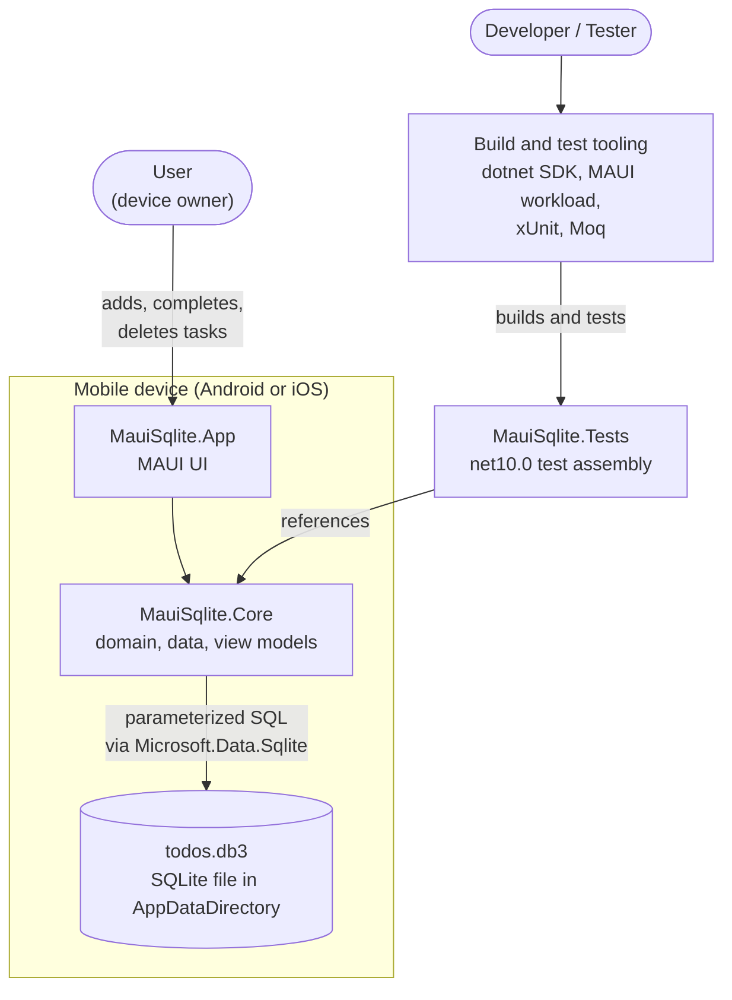
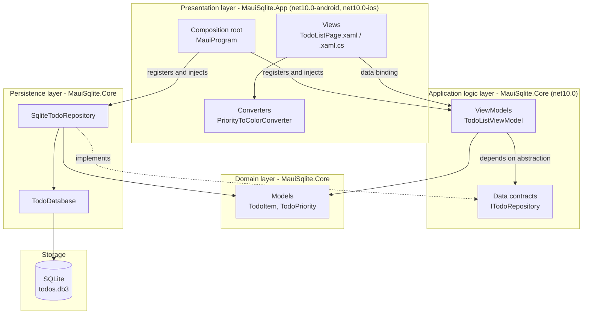
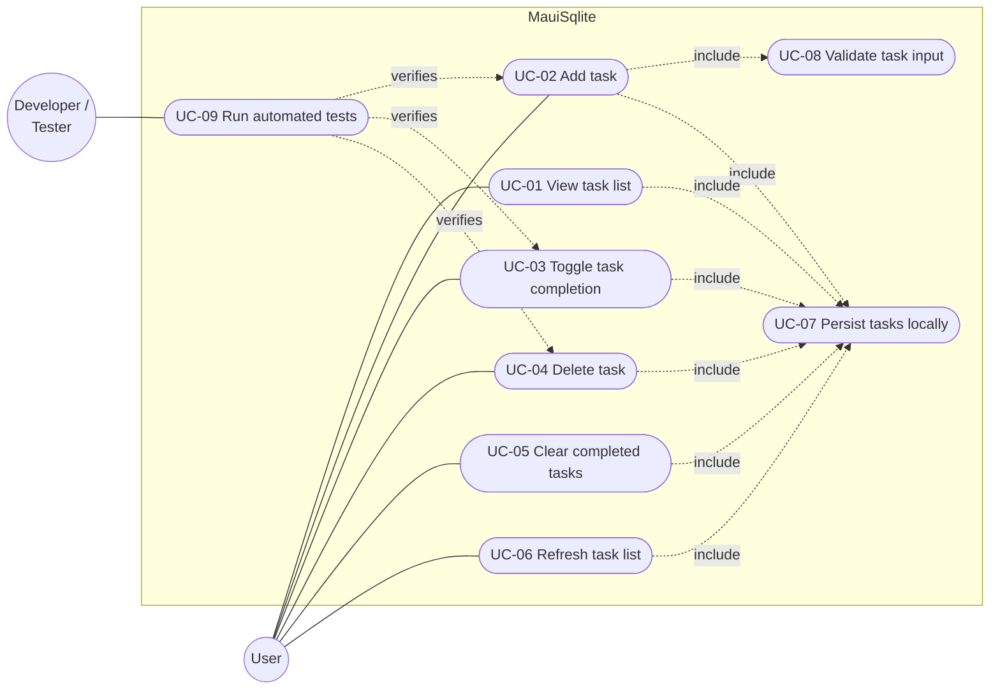
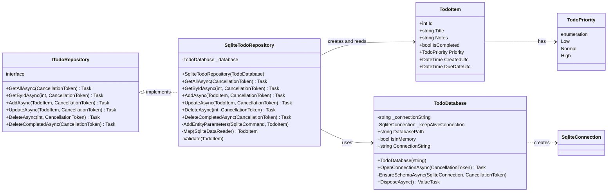
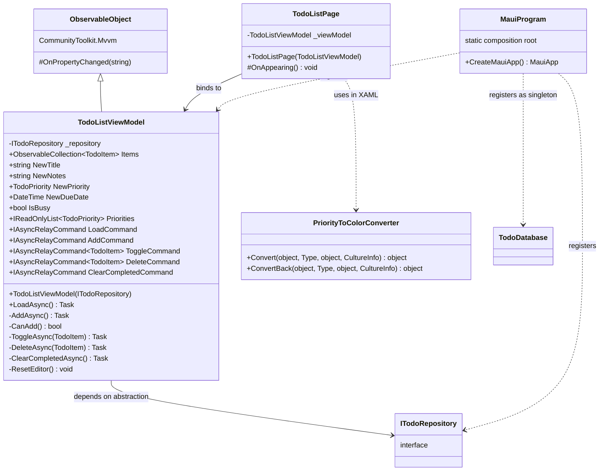
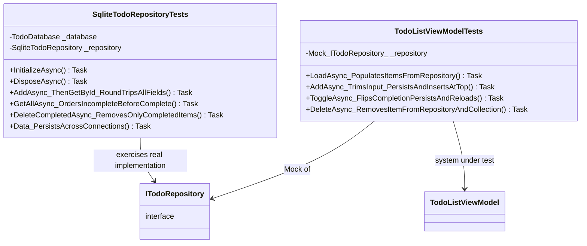
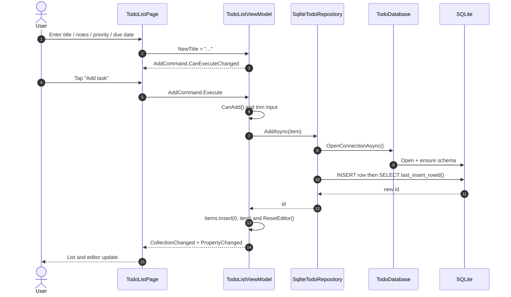
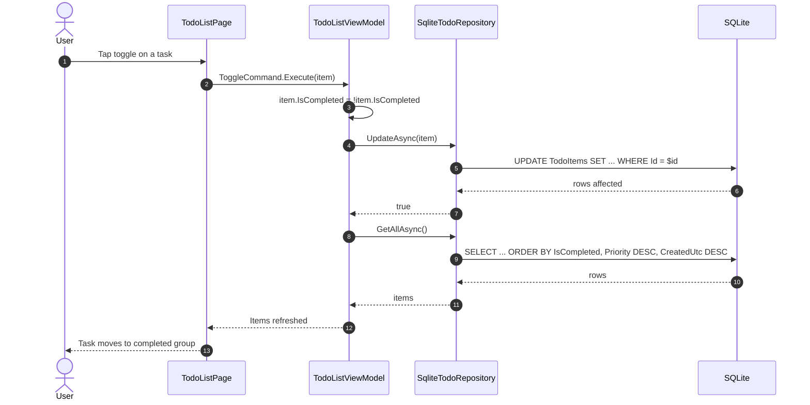
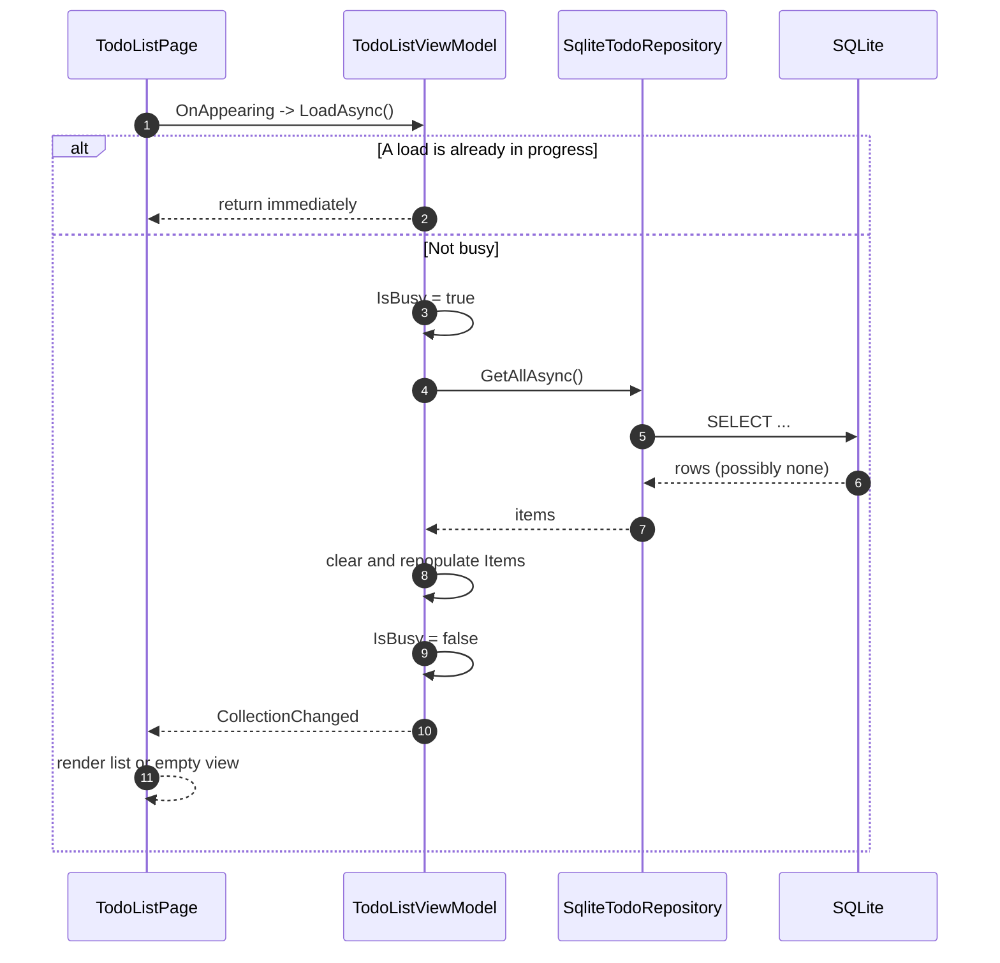
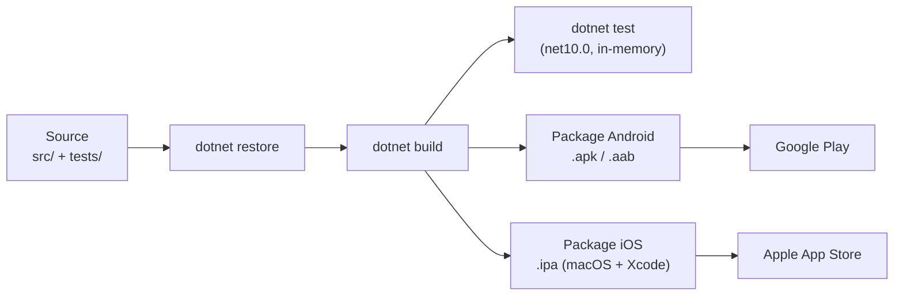

# Architecture Document - MauiSqlite

**Project:** MauiSqlite - cross-platform to-do application
**Version:** 1.0
**Status:** Draft (matches `feature/todo-app-maui-sqlite`)
**Last updated:** 2026-10-20

---

## Table of contents

1. [Introduction](#1-introduction)
2. [System context](#2-system-context)
3. [Architecture overview](#3-architecture-overview)
4. [Use case diagram and use cases](#4-use-case-diagram-and-use-cases)
5. [Class diagram](#5-class-diagram)
6. [Data model](#6-data-model)
7. [Software patterns](#7-software-patterns)
8. [Dynamic behaviour (sequence diagrams)](#8-dynamic-behaviour-sequence-diagrams)
9. [Hardware requirements](#9-hardware-requirements)
10. [Software requirements](#10-software-requirements)
11. [Testing architecture](#11-testing-architecture)
12. [Quality attributes](#12-quality-attributes)
13. [Deployment and build](#13-deployment-and-build)
14. [Risks and future work](#14-risks-and-future-work)
15. [Appendix - traceability](#15-appendix--traceability)

---

## 1. Introduction

### 1.1 Purpose

This document describes the architecture of **MauiSqlite**, a to-do list mobile
application built with .NET 10 MAUI in C#. It covers the software patterns used,
the use cases the system supports, the static class structure, and the hardware
and software requirements needed to build, run, and test the system.

### 1.2 Scope

The system lets a single user manage a personal list of tasks on a mobile
device. Tasks are stored locally on the device using Microsoft.Data.Sqlite, so
the application works fully offline and requires no server or account.

In scope:

- Creating, reading, updating, and deleting to-do items.
- Marking tasks complete and clearing completed tasks.
- Local SQLite persistence.
- Automated unit and integration tests.

Out of scope (current version):

- Multi-user accounts, authentication, and cloud sync.
- Sharing tasks between devices.
- Push notifications and reminders.
- Attachments and rich text.

### 1.3 Definitions and acronyms

| Term | Meaning |
| --- | --- |
| MAUI | .NET Multi-platform App UI |
| MVVM | Model-View-ViewModel |
| DI | Dependency Injection |
| UC | Use case |
| ORM | Object-Relational Mapper (not used here; raw ADO.NET is used) |

### 1.4 References

- .NET MAUI documentation - <https://learn.microsoft.com/dotnet/maui>
- Microsoft.Data.Sqlite - <https://learn.microsoft.com/dotnet/standard/data/sqlite>
- CommunityToolkit.Mvvm - <https://learn.microsoft.com/dotnet/communitytoolkit/mvvm>
- xUnit - <https://xunit.net>
- Moq - <https://github.com/devlooped/moq>

---

## 2. System context

MauiSqlite is a self-contained mobile application. It has no network
dependency at runtime; the only external boundary is the device file system
where the SQLite database file is stored.



**Context notes**

- There is no backend service, API gateway, or message broker.
- The database is a single file local to the application sandbox; the
  application is the only writer.
- The test assembly runs on a desktop .NET 10 runtime and never touches a
  real device database; it uses an in-memory SQLite instance.

---

## 3. Architecture overview

### 3.1 Layered structure

The solution is split into three projects with a strict one-way dependency
direction: `App -> Core`, and `Tests -> Core`. `Core` depends on neither of the
others, which is what makes it fully unit testable without a device or UI.



### 3.2 Project responsibilities

| Project | Target framework(s) | Responsibility |
| --- | --- | --- |
| `src/MauiSqlite.Core` | `net10.0` | Domain model, repository contract and SQLite implementation, and the shared `TodoListViewModel`. No MAUI types, so it is portable and testable. |
| `src/MauiSqlite.App` | `net10.0-android`, `net10.0-ios` (+ `net10.0-maccatalyst`, `net10.0-windows` on capable hosts) | XAML views, value converters, platform heads, and the DI composition root. |
| `tests/MauiSqlite.Tests` | `net10.0` | xUnit tests for the repository (real in-memory SQLite) and the view model (Moq). |

### 3.3 Key architectural decisions

| # | Decision | Rationale |
| --- | --- | --- |
| AD-1 | Put the view model in the shared `Core` library, not the MAUI app. | The test project targets `net10.0` and cannot reference a MAUI-only assembly, so keeping logic in `Core` makes it testable on CI without a device. |
| AD-2 | Use raw `Microsoft.Data.Sqlite` (ADO.NET) instead of an ORM such as EF Core. | The data model is tiny and the requirement explicitly named Microsoft.Data.Sqlite. Raw SQL keeps the dependency surface small and the behaviour explicit. |
| AD-3 | Depend on the `ITodoRepository` abstraction, not the concrete repository. | Enables substitution with Moq in unit tests and keeps the view model decoupled from storage. |
| AD-4 | Store the database in `FileSystem.AppDataDirectory`. | This path is private to the application on every supported platform and survives app updates. |
| AD-5 | Use `CREATE TABLE IF NOT EXISTS` for schema setup, executed on connection open. | Avoids a migration framework for a single-table schema while remaining idempotent. |
| AD-6 | Use `CommunityToolkit.Mvvm` source generators. | Produces compile-time `INotifyPropertyChanged` and `ICommand` implementations with minimal boilerplate. |
| AD-7 | Support an in-memory SQLite mode in `TodoDatabase`. | Allows tests to exercise the real SQL against an isolated, fast, throwaway database. |

---

## 4. Use case diagram and use cases

### 4.1 Use case diagram



### 4.2 Actors

| Actor | Type | Description |
| --- | --- | --- |
| User | Primary, human | The device owner who manages their personal task list. |
| Developer / Tester | Secondary, human | Builds and runs the automated test suite. |
| SQLite engine | Supporting, system | Local persistence provided by `Microsoft.Data.Sqlite`; participates in UC-07. |

### 4.3 Use case catalogue

#### UC-01 View task list

| Field | Detail |
| --- | --- |
| Actor | User |
| Goal | See all current tasks, ordered usefully. |
| Preconditions | Application is running; the database is initialized. |
| Main flow | 1. The page appears. 2. The view model calls `GetAllAsync`. 3. The repository returns rows ordered by completion, then priority, then creation time. 4. The list renders; an empty state appears when there are no tasks. |
| Postconditions | The UI shows the current task set. |
| Realized by | `TodoListPage.OnAppearing` -> `TodoListViewModel.LoadAsync` -> `ITodoRepository.GetAllAsync` |

#### UC-02 Add task

| Field | Detail |
| --- | --- |
| Actor | User |
| Goal | Create a new task with a title, optional notes, priority, and optional due date. |
| Preconditions | A non-blank title has been entered. |
| Main flow | 1. The user types a title and optionally notes, priority, and a due date. 2. The user taps **Add task**. 3. Input is validated and trimmed. 4. The item is inserted and receives a generated id. 5. The item is added to the top of the list. 6. The editor is cleared. |
| Alternate flow | A1 - Title is blank: the Add command is disabled and the handler returns without persisting. |
| Postconditions | A new row exists in `TodoItems`; the editor is reset. |
| Realized by | `TodoListViewModel.AddAsync`, `CanAdd`, `ResetEditor` |
| Includes | UC-07 Persist tasks locally, UC-08 Validate task input |

#### UC-03 Toggle task completion

| Field | Detail |
| --- | --- |
| Actor | User |
| Goal | Mark a task complete, or return it to incomplete. |
| Preconditions | At least one task exists. |
| Main flow | 1. The user activates the task's toggle action. 2. `IsCompleted` is flipped. 3. The change is persisted. 4. The list is reloaded so ordering reflects the new state. |
| Alternate flow | A1 - No task is supplied: the handler returns without side effects. |
| Postconditions | The stored completion flag and list order reflect the change. |
| Realized by | `TodoListViewModel.ToggleAsync` |
| Includes | UC-07 |

#### UC-04 Delete task

| Field | Detail |
| --- | --- |
| Actor | User |
| Goal | Remove a single task permanently. |
| Preconditions | The task exists in the list. |
| Main flow | 1. The user activates the task's delete action. 2. The row is deleted by id. 3. The item is removed from the in-memory collection. |
| Alternate flow | A1 - No task is supplied: the handler returns without side effects. |
| Postconditions | The row no longer exists; the list no longer shows it. |
| Realized by | `TodoListViewModel.DeleteAsync` |
| Includes | UC-07 |

#### UC-05 Clear completed tasks

| Field | Detail |
| --- | --- |
| Actor | User |
| Goal | Remove every completed task in one action. |
| Preconditions | Application is running. |
| Main flow | 1. The user taps **Clear completed**. 2. All rows with `IsCompleted = 1` are deleted. 3. The list is reloaded. |
| Postconditions | No completed tasks remain. |
| Realized by | `TodoListViewModel.ClearCompletedAsync` -> `DeleteCompletedAsync` |
| Includes | UC-07 |

#### UC-06 Refresh task list

| Field | Detail |
| --- | --- |
| Actor | User |
| Goal | Re-read tasks from storage on demand. |
| Preconditions | Application is running. |
| Main flow | 1. The user performs pull-to-refresh. 2. The list reloads from the database. |
| Alternate flow | A1 - A load is already running: the request is ignored to avoid re-entrancy. |
| Postconditions | The UI reflects the current database contents. |
| Realized by | `TodoListViewModel.LoadAsync` (guarded by `IsBusy`) |

#### UC-07 Persist tasks locally (system use case)

| Field | Detail |
| --- | --- |
| Actor | SQLite engine (supporting) |
| Goal | Durable, local storage of tasks with no network dependency. |
| Main flow | 1. A connection is opened. 2. The schema is ensured. 3. A parameterized statement is executed. 4. The connection is disposed. |
| Postconditions | Changes are committed to `todos.db3`. |
| Realized by | `TodoDatabase`, `SqliteTodoRepository` |

#### UC-08 Validate task input

| Field | Detail |
| --- | --- |
| Actor | System |
| Goal | Reject invalid data before it reaches storage. |
| Rules | Title must be non-blank; title and notes are trimmed; blank notes are stored as `NULL`; null items are rejected. |
| Realized by | `TodoListViewModel.CanAdd`, `SqliteTodoRepository.Validate` |

#### UC-09 Run automated tests

| Field | Detail |
| --- | --- |
| Actor | Developer / Tester |
| Goal | Verify repository and view model behaviour. |
| Main flow | 1. Run `dotnet test`. 2. Repository tests run against an in-memory database. 3. View model tests run against a mocked repository. 4. A pass/fail summary is produced. |
| Postconditions | Test results reported. |
| Realized by | `tests/MauiSqlite.Tests` |

### 4.4 Use case to implementation map

| Use case | View | View model member | Repository member |
| --- | --- | --- | --- |
| UC-01 | `TodoListPage` | `LoadAsync` | `GetAllAsync` |
| UC-02 | `TodoListPage` | `AddAsync` / `AddCommand` | `AddAsync` |
| UC-03 | `TodoListPage` | `ToggleAsync` / `ToggleCommand` | `UpdateAsync`, `GetAllAsync` |
| UC-04 | `TodoListPage` | `DeleteAsync` / `DeleteCommand` | `DeleteAsync` |
| UC-05 | `TodoListPage` | `ClearCompletedAsync` | `DeleteCompletedAsync` |
| UC-06 | `TodoListPage` | `LoadAsync` / `LoadCommand` | `GetAllAsync` |
| UC-07 | - | - | `TodoDatabase`, `SqliteTodoRepository` |
| UC-08 | `TodoListPage` | `CanAdd` | `Validate` |
| UC-09 | - | test assembly | in-memory `TodoDatabase` |

---

## 5. Class diagram

### 5.1 Domain and data access



### 5.2 Presentation and view model



### 5.3 Test classes



---

## 6. Data model

### 6.1 Logical entity

`TodoItem` is the only persisted entity.

| Property | CLR type | Nullable | Notes |
| --- | --- | --- | --- |
| `Id` | `int` | No | Primary key, autoincrement. Assigned on insert. |
| `Title` | `string` | No | Required, non-blank. |
| `Notes` | `string?` | Yes | Optional free text. |
| `IsCompleted` | `bool` | No | Defaults to `false`. |
| `Priority` | `TodoPriority` | No | `Low`/`Normal`/`High`; defaults to `Normal`. |
| `CreatedUtc` | `DateTime` | No | UTC timestamp; defaults to `DateTime.UtcNow`. |
| `DueDateUtc` | `DateTime?` | Yes | Optional UTC due date. |

### 6.2 Physical schema

```sql
CREATE TABLE IF NOT EXISTS TodoItems (
    Id           INTEGER PRIMARY KEY AUTOINCREMENT,
    Title        TEXT    NOT NULL,
    Notes        TEXT    NULL,
    IsCompleted  INTEGER NOT NULL DEFAULT 0,
    Priority     INTEGER NOT NULL DEFAULT 1,
    CreatedUtc   TEXT    NOT NULL,
    DueDateUtc   TEXT    NULL
);

CREATE INDEX IF NOT EXISTS IX_TodoItems_IsCompleted
    ON TodoItems (IsCompleted);
```

**Mapping conventions**

- `bool` is stored as `INTEGER` (`0`/`1`).
- `TodoPriority` is stored as its underlying `INTEGER` value.
- `DateTime` values are normalized to UTC and stored as ISO-8601 round-trip
  strings (`"o"` format) so ordering and parsing are unambiguous.
- All SQL is parameterized (`$name` placeholders); user input is never
  concatenated into a statement.

### 6.3 Ordering rule

`GetAllAsync` returns rows ordered by:

1. `IsCompleted` ascending - incomplete tasks first.
2. `Priority` descending - `High`, then `Normal`, then `Low`.
3. `CreatedUtc` descending - newest first within the same group.

---

## 7. Software patterns

### 7.1 MVVM (Model-View-ViewModel)

**Where:** `TodoListPage` (View) <-> `TodoListViewModel` (ViewModel) <-> `TodoItem` (Model).

The view holds no application logic. It declares bindings in XAML, and the view
model exposes observable state (`Items`, `NewTitle`, `IsBusy`) and commands
(`AddCommand`, `ToggleCommand`, `DeleteCommand`, `ClearCompletedCommand`,
`LoadCommand`). `CommunityToolkit.Mvvm` source generators produce the
`INotifyPropertyChanged` and `ICommand` plumbing at compile time.

**Benefit:** the presentation logic is testable without instantiating any UI.

### 7.2 Repository pattern

**Where:** `ITodoRepository` / `SqliteTodoRepository`.

The repository mediates between the domain and the data-mapping layer,
presenting an in-memory collection-like interface over SQLite. The view model
never sees SQL, connections, or readers.

**Benefit:** storage can be replaced (for example, with a remote API or a fake)
without changing the view model.

### 7.3 Dependency Injection / Inversion of Control

**Where:** `MauiProgram.CreateMauiApp`.

Registrations:

| Service | Lifetime | Implementation |
| --- | --- | --- |
| `TodoDatabase` | Singleton | Instance built from `FileSystem.AppDataDirectory` |
| `ITodoRepository` | Singleton | `SqliteTodoRepository` |
| `TodoListViewModel` | Transient | Concrete type |
| `TodoListPage` | Transient | Concrete type |

The view model receives `ITodoRepository` through its constructor. It never
constructs its own dependencies.

**Benefit:** loose coupling, centralized composition, and easy substitution in
tests.

### 7.4 Dependency inversion principle

The high-level policy (`TodoListViewModel`) depends on an abstraction
(`ITodoRepository`); the low-level detail (`SqliteTodoRepository`) also depends
on that abstraction by implementing it. This is the classic DIP arrangement and
is what allows the Moq-based unit tests to run without a database.

### 7.5 Factory (connection factory)

**Where:** `TodoDatabase.OpenConnectionAsync`.

Instead of exposing a shared, long-lived connection, `TodoDatabase` acts as a
factory that produces a fresh, open, schema-ensured `SqliteConnection` on
demand. Callers dispose it deterministically with `await using`.

**Benefit:** avoids cross-thread sharing of a single connection and keeps
connection lifetime local and predictable.

### 7.6 Singleton (lifetime scope)

`TodoDatabase` is registered as a singleton. This is deliberate: an in-memory
SQLite database is destroyed when its last connection closes, so
`TodoDatabase` holds one keep-alive connection for its lifetime. In the
file-backed case the same registration simply avoids redundant construction.

### 7.7 Observer (data binding)

MAUI data binding is an implementation of the Observer pattern. The view
subscribes to `PropertyChanged` notifications raised by the view model and to
`INotifyCollectionChanged` from the `ObservableCollection<TodoItem>`, and
updates itself when those fire.

### 7.8 Command pattern

User actions are encapsulated as command objects generated from the view
model's methods. `AddCommand` additionally carries a guard through
`CanExecute = nameof(CanAdd)`, which is the Command pattern's enabled/disabled
predicate. This decouples the button press from the action's implementation.

### 7.9 Data Mapper

**Where:** `SqliteTodoRepository.Map` and `AddEntityParameters`.

Rows are translated to domain objects and back explicitly. The domain object
carries no persistence attributes or knowledge of the schema, so the two can
evolve somewhat independently.

### 7.10 Value Object (enumeration)

`TodoPriority` is an immutable enumeration used as a value, not an entity. It
has no identity and is compared by value.

### 7.11 Template Method (framework hooks)

`TodoListPage.OnAppearing` overrides a framework-defined lifecycle hook to
trigger the initial load. `IAsyncLifetime` in the test class does the same for
xUnit's setup and teardown.

### 7.12 Test Double / Mock object

**Where:** `TodoListViewModelTests`.

`Mock<ITodoRepository>` (Moq, strict behaviour) is a test double that stands in
for the repository. Interactions are verified with `Verify` and `SetupSequence`,
which isolates the view model from storage.

### 7.13 Pattern summary

| Pattern | Category | Primary location |
| --- | --- | --- |
| MVVM | Architectural / presentation | App + Core view models |
| Repository | Data access | `ITodoRepository`, `SqliteTodoRepository` |
| Dependency Injection | Creational / structural | `MauiProgram` |
| Dependency inversion | Structural | View model <-> interface |
| Factory | Creational | `TodoDatabase.OpenConnectionAsync` |
| Singleton | Creational | `TodoDatabase` registration |
| Observer | Behavioural | MAUI data binding |
| Command | Behavioural | `[RelayCommand]` members |
| Data Mapper | Data access | `Map`, `AddEntityParameters` |
| Value object | Domain | `TodoPriority` |
| Template method | Behavioural | `OnAppearing`, `IAsyncLifetime` |
| Test double / mock | Testing | `TodoListViewModelTests` |

---

## 8. Dynamic behaviour (sequence diagrams)

### 8.1 Add a task



### 8.2 Toggle completion



### 8.3 Initial load with empty state



---

## 9. Hardware requirements

### 9.1 End-user device (runtime)

| Platform | Minimum | Recommended |
| --- | --- | --- |
| Android | Android 5.0 (API 21) or later - matches `SupportedOSPlatformVersion` = 21.0; ARM64 or x86_64 | Android 13+ device with 4 GB RAM |
| iOS | iOS 15.0 or later - matches `SupportedOSPlatformVersion` = 15.0 | Recent iPhone or iPad |
| Storage | About 50 MB for the app plus the size of the SQLite file (kilobytes for typical use) | - |
| Network | Not required at runtime; the app is fully offline | - |
| Camera / sensors | Not used | - |

### 9.2 Development and build machine

| Component | Minimum | Notes |
| --- | --- | --- |
| CPU | 2 cores, x64 or ARM64 | 4+ cores recommended for MAUI builds |
| RAM | 8 GB | 16 GB recommended |
| Disk | About 15 GB free | .NET SDK, MAUI workload packs, Android SDK, JDK, NuGet cache, and build output |
| OS (Android build) | Windows 10/11, macOS 12+, or Linux | Android targets build on all three |
| OS (iOS build) | macOS 12+ with Xcode | Required by Apple tooling; iOS cannot be built on Linux or Windows |
| Display | Any | An emulator or physical device is needed to run the app |

### 9.3 Test execution machine

| Component | Minimum | Notes |
| --- | --- | --- |
| CPU | Any x64/ARM64 | Tests are lightweight |
| RAM | 2 GB | In-memory SQLite |
| Disk | About 1 GB | Restore and build artifacts |
| Device | None required | The test project targets `net10.0` and needs no emulator |

---

## 10. Software requirements

### 10.1 Runtime software (device)

| Item | Version | Purpose |
| --- | --- | --- |
| .NET MAUI runtime | Bundled with the app | UI framework |
| `Microsoft.Maui.Controls` | `$(MauiVersion)` for .NET 10 | Controls, XAML, binding |
| `CommunityToolkit.Mvvm` | 8.4.2 | MVVM source generators |
| `Microsoft.Data.Sqlite` | 10.0.13 | SQLite ADO.NET provider |
| SQLite native library | Bundled by the provider (`SQLitePCLRaw`) | Native database engine |

The app carries its managed and native dependencies inside the package, so no
separate runtime install is required on the device.

### 10.2 Development tooling

| Item | Version | Purpose |
| --- | --- | --- |
| .NET SDK | 10.0 (validated with 10.0.402) | Build and test |
| MAUI workload | `maui-android` (and `maui-ios` on macOS) | Platform targeting packs |
| Java JDK | 17 or later (validated with OpenJDK 21) | Required by the Android build toolchain |
| Android SDK | API 36 platform, build-tools, platform-tools | Required to build the Android target |
| ICU libraries (`libicu`) | System package | Required by the .NET runtime on Linux |
| Xcode | Current version (macOS only) | Required to build and sign the iOS target |
| IDE (optional) | Visual Studio 2022 17.12+, VS Code, or Rider | Editing and debugging |

### 10.3 Package dependencies

| Project | Package | Version |
| --- | --- | --- |
| `MauiSqlite.Core` | `Microsoft.Data.Sqlite` | 10.0.13 |
| `MauiSqlite.Core` | `CommunityToolkit.Mvvm` | 8.4.2 |
| `MauiSqlite.App` | `Microsoft.Maui.Controls` | `$(MauiVersion)` |
| `MauiSqlite.App` | `CommunityToolkit.Mvvm` | 8.4.2 |
| `MauiSqlite.App` | `Microsoft.Extensions.Logging.Debug` | 10.0.0 |
| `MauiSqlite.Tests` | `xunit` | 2.9.3 |
| `MauiSqlite.Tests` | `xunit.runner.visualstudio` | 3.1.4 |
| `MauiSqlite.Tests` | `Microsoft.NET.Test.Sdk` | 17.14.1 |
| `MauiSqlite.Tests` | `Moq` | 4.21.0 |
| `MauiSqlite.Tests` | `coverlet.collector` | 6.0.4 |

### 10.4 Target frameworks

| Project | Frameworks |
| --- | --- |
| `MauiSqlite.Core` | `net10.0` |
| `MauiSqlite.App` | `net10.0-android`, `net10.0-ios`, `net10.0-maccatalyst` (non-Linux), `net10.0-windows10.0.19041.0` (Windows host) |
| `MauiSqlite.Tests` | `net10.0` |

### 10.5 Commands

```bash
# Install the workload (add maui-ios on macOS)
dotnet workload install maui-android

# Restore, build, and test
dotnet test tests/MauiSqlite.Tests/MauiSqlite.Tests.csproj

# Build the Android app
dotnet build src/MauiSqlite.App/MauiSqlite.App.csproj -f net10.0-android

# Build the iOS app (macOS with Xcode only)
dotnet build src/MauiSqlite.App/MauiSqlite.App.csproj -f net10.0-ios
```

### 10.6 Permissions and configuration

- No runtime permissions are requested: the app needs no camera, location,
  network, or contacts access.
- The database is created in `FileSystem.AppDataDirectory`, which maps to the
  private app sandbox on each platform.
- `ApplicationId` is `com.companyname.mauisqlite.app` and `ApplicationTitle` is
  `MauiSqlite.App`; both are placeholder values to be set before store release.

---

## 11. Testing architecture

### 11.1 Strategy

The test suite follows the test pyramid's lower tiers: many fast unit tests over
the view model, plus integration-style tests that exercise the real SQL against
an isolated in-memory database. No UI automation or device tests are included
in the current version.

| Layer | Test class | Double used | What it proves |
| --- | --- | --- | --- |
| View model | `TodoListViewModelTests` | `Mock<ITodoRepository>` (Moq, strict) | Command behaviour, validation, trimming, editor reset, collection updates |
| Data access | `SqliteTodoRepositoryTests` | Real `SqliteTodoRepository` over in-memory SQLite | SQL correctness, mapping, ordering, null handling, persistence |

### 11.2 Isolation technique

`SqliteTodoRepositoryTests` implements `IAsyncLifetime`. Each test gets a fresh
`TodoDatabase(":memory:")` and a repository over it; `DisposeAsync` closes the
keep-alive connection so the database is discarded. This yields real SQL
coverage with no disk I/O and no cross-test contamination.

### 11.3 Coverage highlights

The suite (30 tests) covers: null-argument guards, id generation, full field
round-trip including UTC dates, null notes and due dates, blank-title rejection,
missing-id lookups, ordering by completion and priority, update and delete
affected-row counts, bulk delete of completed items, and persistence across
separate connections.

### 11.4 Test run result

```
Passed!  - Failed: 0, Passed: 30, Skipped: 0, Total: 30
```

---

## 12. Quality attributes

| Attribute | How it is addressed |
| --- | --- |
| Testability | Logic lives in `Core` with an injected `ITodoRepository`; the repository runs against in-memory SQLite. |
| Maintainability | Three small projects with one-way dependencies; single responsibility per class; no UI types in `Core`. |
| Portability | `Core` targets plain `net10.0`; the UI targets Android and iOS from one shared codebase. |
| Offline capability | Local SQLite storage; no network calls at runtime. |
| Security | Parameterized SQL only (no injection surface); data confined to the app sandbox; no secrets or credentials stored. |
| Performance | Indexed lookups on `IsCompleted`; short-lived connections; small row counts typical of a personal task list. |
| Reliability | Schema creation is idempotent; connections are disposed deterministically with `await using`; commands guard against null and blank input. |
| Accessibility | Standard MAUI controls; an empty state is shown when the list is empty. |

---

## 13. Deployment and build



- Android artifacts are produced with the `net10.0-android` target; the standard
  toolchain emits an APK for sideloading and an AAB for Google Play.
- iOS artifacts require macOS with Xcode, an Apple Developer account, and
  provisioning profiles; the project file already declares the `net10.0-ios`
  target framework and the iOS platform head.
- Versioning uses `ApplicationDisplayVersion` (currently `1.0`) and
  `ApplicationVersion` (currently `1`) in the app project file.

---

## 14. Risks and future work

| # | Risk / gap | Impact | Suggested mitigation |
| --- | --- | --- | --- |
| R-1 | No schema migration strategy beyond `CREATE TABLE IF NOT EXISTS`. | Future column additions will not apply to existing installs. | Add a lightweight version table and ordered migrations, or adopt EF Core migrations if the model grows. |
| R-2 | Single-table, single-user model. | No support for accounts or sync. | Introduce a sync service behind the repository abstraction if needed. |
| R-3 | No UI or device-level automated tests. | Regressions in XAML bindings may go unnoticed. | Add MAUI UI tests (Appium) or at least view-level tests with a test host. |
| R-4 | `ApplicationId` and title are template placeholders. | Not store-ready. | Set a real reverse-DNS identifier and display name before release. |
| R-5 | No notification or reminder feature despite a due-date field. | Due dates are informational only. | Add local notifications scheduled from `DueDateUtc`. |
| R-6 | Tests run on `net10.0` only; platform-specific code is untested. | Platform heads are thin, but untested. | Keep platform heads minimal (they currently are) and cover shared code, as now. |
| R-7 | No CI pipeline committed. | Builds and tests are manual. | Add a GitHub Actions workflow running `dotnet test` on push. |

### Roadmap suggestions

1. CI workflow with `dotnet test` and coverage upload.
2. Schema versioning and migrations.
3. Editing an existing task (currently only create, toggle, and delete).
4. Search, filter, and sort options.
5. Reminders via local notifications.
6. Optional cloud sync behind the existing repository interface.

---

## 15. Appendix - traceability

### 15.1 Requirements to artifacts

| Requirement | Artifact(s) |
| --- | --- |
| To-do app for iOS and Android in .NET 10 MAUI C# | `MauiSqlite.App` (`net10.0-android`, `net10.0-ios`), `TodoListPage` |
| Use Microsoft.Data.Sqlite to store and retrieve data | `MauiSqlite.Core/Data` (`TodoDatabase`, `SqliteTodoRepository`), `Microsoft.Data.Sqlite` 10.0.13 |
| Unit test project in xUnit and Moq | `MauiSqlite.Tests` (xUnit 2.9.3, Moq 4.21.0) |
| Push to a new branch and open a PR | Branch `feature/todo-app-maui-sqlite`, PR #1 |
| Architecture document in `docs/` | This file |

### 15.2 Source file index

| File | Layer | Purpose |
| --- | --- | --- |
| `src/MauiSqlite.Core/Models/TodoItem.cs` | Domain | Task entity |
| `src/MauiSqlite.Core/Models/TodoPriority.cs` | Domain | Priority value object |
| `src/MauiSqlite.Core/Data/ITodoRepository.cs` | Contracts | Persistence abstraction |
| `src/MauiSqlite.Core/Data/SqliteTodoRepository.cs` | Persistence | Parameterized SQL implementation |
| `src/MauiSqlite.Core/Data/TodoDatabase.cs` | Persistence | Connection factory and schema setup |
| `src/MauiSqlite.Core/ViewModels/TodoListViewModel.cs` | Presentation logic | Screen state and commands |
| `src/MauiSqlite.App/Views/TodoListPage.xaml` | Presentation | List UI and bindings |
| `src/MauiSqlite.App/Views/TodoListPage.xaml.cs` | Presentation | Page code-behind and lifecycle |
| `src/MauiSqlite.App/Converters/PriorityToColorConverter.cs` | Presentation | Priority to colour mapping |
| `src/MauiSqlite.App/MauiProgram.cs` | Composition | DI registrations |
| `tests/MauiSqlite.Tests/Data/SqliteTodoRepositoryTests.cs` | Test | Repository integration tests |
| `tests/MauiSqlite.Tests/ViewModels/TodoListViewModelTests.cs` | Test | View model unit tests |
